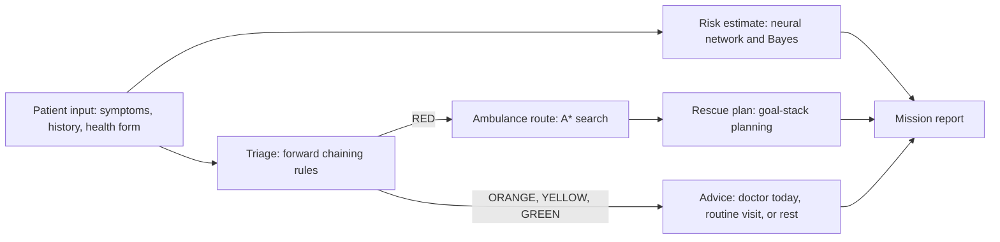
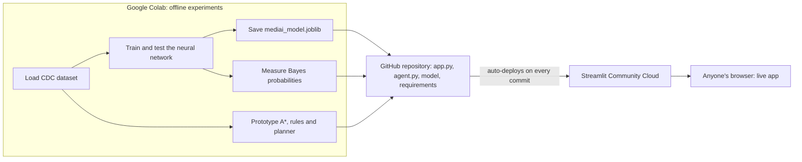

<div align="center">

# 🩺 MediAI: Intelligent Medical Emergency Agent

**One AI agent that triages a patient, estimates diabetes risk, dispatches an ambulance along the fastest route, and plans the rescue.**

[](https://mediai-cs24308.streamlit.app)
[](https://colab.research.google.com/github/Abhijeet835/mediai-cs24308/blob/main/MediAI_CS24308.ipynb)


### 👉 Live demo: [https://mediai-cs24308.streamlit.app](https://mediai-cs24308.streamlit.app)

*Educational project. Not a medical device and not medical advice.*

</div>

---

## Table of contents

1. [About the project](#about-the-project)
2. [Try it in 60 seconds](#try-it-in-60-seconds)
3. [What the agent does](#what-the-agent-does)
4. [Syllabus coverage](#syllabus-coverage)
5. [App tabs](#app-tabs)
6. [Results](#results)
7. [How the AI modules work](#how-the-ai-modules-work)
8. [How the project was built (Colab, GitHub, Streamlit)](#how-the-project-was-built)
9. [Project structure](#project-structure)
10. [Tech stack](#tech-stack)
11. [Dataset](#dataset)
12. [Run it locally](#run-it-locally)
13. [Limitations](#limitations)
14. [Future scope](#future-scope)
15. [Team and course details](#team-and-course-details)
16. [References](#references)

---

## About the project

In many parts of India, including rural Jharkhand, there are too few doctors for the number of patients. When someone becomes seriously ill, two things decide the outcome: **how quickly the case is recognised as an emergency**, and **how quickly the ambulance reaches the patient and then the hospital**. Long-term illnesses such as diabetes make things worse because they often go unnoticed until complications appear.

**MediAI** is a prototype intelligent agent that answers four questions about one patient:

| Question | AI method used |
|---|---|
| How urgent is this patient, and why? | IF-THEN rules with **forward chaining** |
| What is the fastest ambulance route? | **A\* search** (compared with BFS and Greedy) |
| How likely is the patient to have diabetes? | **Neural network** and **Bayes' theorem** |
| In what order should the rescue steps happen? | **Goal-stack planning** |

Every part is a different technique from the CS24308 Artificial Intelligence syllabus, joined into a single perceive, reason, act agent.

## Try it in 60 seconds

1. Open the **[live app](https://mediai-cs24308.streamlit.app)**. If it shows a "wake up" button, click it and wait about 30 seconds.
2. In the **Agent mission** tab, click **Patient A (58 yr man, chest pain)**.
3. Click **Run MediAI agent**.
4. Watch the agent show a **RED** triage with the rules that fired, an **A\* ambulance route** on the city map (base to patient to hospital), the **diabetes risk** from the neural network and from Bayes, and a **7-step rescue plan**.
5. Click **Patient D (headache)** and run again: the agent shows **GREEN** and sends no ambulance.

## What the agent does



- **Perceive:** reads symptoms, history and a 21-question health form.
- **Reason:** forward-chaining rules decide the urgency; a neural network and Bayes' theorem estimate diabetes risk.
- **Act:** only for RED patients, it dispatches an ambulance along an A\* route (base to patient, then patient to hospital) and builds an ordered rescue plan. For everyone it produces a downloadable mission report.

## Syllabus coverage

| Syllabus module | Technique | Where in the project |
|---|---|---|
| I. Preliminaries | Intelligent agent: perceive, reason, act | `run_mission()` in `agent.py`, Agent mission tab |
| II. Problem solving by search | BFS, Greedy best-first, A\* (heuristic search) | `bfs()`, `greedy()`, `astar()` in `agent.py`, Ambulance routing tab |
| III. Knowledge representation and reasoning | Rule base and forward chaining (propositional logic) | `RULES`, `forward_chain()` in `agent.py`, triage |
| IV. Planning and probabilistic reasoning | Goal-stack planning, Bayes' theorem | `goal_stack_plan()`, `bayes_update()` in `agent.py`, Bayes reasoning tab |
| V. Learning | Neural network (MLP), underfitting and overfitting | Trained in the Colab notebook, used in `app.py`, Risk checker tab |

## App tabs

| Tab | What it does |
|---|---|
| **Agent mission** | Pick a demo patient or enter symptoms. Shows the triage card, rules that fired, both risk estimates, ambulance route on the map, rescue plan with its trace, and a downloadable report. |
| **Risk checker** | A 21-input form that returns the neural-network score, an estimated real-world risk in a colour-coded card, and a "what if my BMI were healthy" comparison. |
| **Ambulance routing** | BFS, Greedy and A\* side by side on the same city map, with charts. |
| **Bayes reasoning** | Mark each finding Present, Absent or Unknown and watch the probability of diabetes change step by step. |
| **Model performance** | AUC, accuracy, recall, precision and the confusion matrix. |
| **About the team** | Team members, course and dataset. |

## Results

### Neural network (on 50,736 unseen patients)

| Metric | Value |
|---|---|
| AUC | **0.824** |
| Accuracy | 70.8% |
| Recall for diabetic patients | **81%** (5,712 of 7,069 found, 1,357 missed) |
| Precision for diabetic patients | 30% |

Only 13.9% of patients are diabetic, so plain accuracy is misleading (a model that always says "healthy" would be right about 86% of the time and find nobody). The model is therefore judged on **recall and AUC**, which suits a screening tool where missing a sick patient is worse than one extra blood test.

### Ambulance routing (the web app's city map: 20 x 20, traffic cells cost 3 minutes)

| Algorithm | Travel time | Cells explored | Fastest? |
|---|---|---|---|
| BFS | 48 min | 359 | No (ignores traffic) |
| Greedy best-first | 44 min | 54 | No (ignores time already spent) |
| **A\*** | **36 min** | 230 | **Yes** |

A\* is guaranteed to find the fastest route because its heuristic, the Manhattan distance, never overestimates: every cell costs at least 1 minute.

## How the AI modules work

### Module II: Search (`agent.py`)
The city is a 20 x 20 grid of clear roads (1 minute), traffic jams (3 minutes) and blocked cells. All three algorithms find a route on the same map and differ only in how they choose the next cell:
- **BFS** uses a queue and counts steps only.
- **Greedy** uses a priority queue ordered by **h** (Manhattan distance to the goal).
- **A\*** uses a priority queue ordered by **f = g + h**, where **g** is the minutes spent so far and **h** is the Manhattan distance left.

### Module III: Rules and forward chaining (`agent.py`)
Medical knowledge is stored as 17 IF-THEN rules over true/false facts, for example `IF chest_pain AND sweating THEN suspect_heart_attack`. `forward_chain()` starts from the patient's facts, fires every rule whose conditions are met, adds the new facts, and repeats until nothing new appears. The most serious level reached decides the triage colour. The fired rules are shown so every decision can be explained.

### Module IV: Bayes' theorem and goal-stack planning (`agent.py`)
- `bayes_update()` starts from the real prevalence (13.9%) and multiplies the odds by each finding's likelihood ratio. The probabilities in `EVIDENCE` were measured on the 253,680-patient dataset in the notebook. The method assumes the findings are independent, which is a simplification, so it tends to give higher values than the neural network.
- `goal_stack_plan()` puts the goal "under treatment" on a stack and repeatedly replaces an unmet goal with the action that achieves it plus that action's preconditions, producing an ordered plan.

### Module V: Neural network (notebook and `app.py`)
A multilayer perceptron (21 inputs, hidden layers of 64 and 32 neurons, 1 output) was trained once in Google Colab. The training set was balanced by undersampling, features were standardised, and early stopping was used. Because it was trained on a 50/50 sample, its raw score overestimates real risk, so the app corrects it with **Bayes' theorem using the real prior** (`real_risk()` in `app.py`). The app only loads the trained model; it does not train.

## How the project was built

The work is split between three places, each with one job:



| Place | Role in this project |
|---|---|
| **Google Colab** (notebook `MediAI_CS24308.ipynb`) | Where the AI work was developed and tested: loading the dataset, preparing the data, training and evaluating the neural network, the underfitting and overfitting experiments, feature importance, measuring the Bayes probabilities, and prototyping the search, rules and planner. It produced the trained model file and the numbers used by the app. |
| **GitHub** (this repository) | Stores the final code and the model file. Streamlit reads from here. |
| **Streamlit Community Cloud** | Pulls the repository, installs `requirements.txt`, runs `app.py`, and gives the public link. Every new commit redeploys the app automatically. |

The notebook is kept in this repository so the experiments and their outputs (charts, metrics) can be viewed directly on GitHub, or re-run in Colab with the **Open in Colab** badge above.

### How the web interface is built
The interface is written entirely in Python with **Streamlit**, with no hand-written HTML, JavaScript or React. The script re-runs from top to bottom whenever the user interacts, and widgets such as `st.tabs`, `st.columns`, `st.selectbox`, `st.slider`, `st.multiselect`, `st.button` and `st.metric` create the page. `st.session_state` keeps the demo-patient form values, `st.cache_resource` loads the model once, and `st.pyplot` and `st.image` display the maps and charts drawn with Matplotlib. Small custom CSS in `app.py` styles the metric boxes and the colour-coded triage card, and `.streamlit/config.toml` sets the dark theme.

## Project structure

```
mediai-cs24308/
├── app.py                  # Streamlit web app (interface and glue code)
├── agent.py                # AI modules: search, rules, Bayes, planner, mission runner
├── mediai_model.joblib     # Trained neural network, scaler, feature list, base rate
├── requirements.txt        # Python dependencies
├── MediAI_CS24308.ipynb    # Google Colab notebook: data, training, experiments
├── .streamlit/
│   └── config.toml         # Dark theme settings
└── README.md
```

## Tech stack

| Layer | Tools |
|---|---|
| Language | Python 3.12 |
| Web app (frontend) | Streamlit, custom CSS, Matplotlib charts |
| AI and ML | scikit-learn 1.6.1 (MLPClassifier, StandardScaler), NumPy, pandas |
| Search, rules, Bayes, planning | Written from scratch in plain Python (`heapq`, `deque`, dictionaries) |
| Model storage | joblib |
| Experiments | Google Colab |
| Hosting | GitHub and Streamlit Community Cloud |

## Dataset

**CDC Diabetes Health Indicators**, from the UCI Machine Learning Repository (dataset id 891), derived from the CDC's 2015 Behavioral Risk Factor Surveillance System survey.
- 253,680 patients and 21 features (blood pressure, cholesterol, BMI, smoking, activity, general health, age, education, income and more)
- Label: 0 = no diabetes, 1 = prediabetes or diabetes
- No missing values, and strongly imbalanced (13.9% positive)

## Run it locally

Python 3.12 is recommended because `scikit-learn==1.6.1` is pinned to match the version used for training.

```bash
git clone https://github.com/Abhijeet835/mediai-cs24308.git
cd mediai-cs24308
python -m venv .venv
source .venv/bin/activate          # on Windows: .venv\Scripts\activate
pip install -r requirements.txt
streamlit run app.py
```

The app opens at `http://localhost:8501`.

To re-run the experiments, click the **Open in Colab** badge at the top and choose **Runtime, then Run all**.

## Limitations

- The data are a 2015 survey of people in the United States (income bands are in US dollars). The model should be retrained on Indian data before any real use.
- Survey answers are self-reported, which limits accuracy (about 71%). Precision is 30%, so there are many false alarms. This is a screening aid, not a diagnosis.
- The triage rules and thresholds were written for this demonstration and have not been checked by doctors.
- The city is a simulated grid with fixed traffic costs, not a real map with live traffic.
- The Bayes method assumes findings are independent, which is not true for health data.
- In the Agent mission tab, health-form items that are not asked (for example smoking and physical activity) are set to default values before the neural network runs.
- A real system would need patient consent, data privacy, fairness checks, and a doctor making the final decision.

## Future scope

- Have doctors review and extend the rules, and add more diseases.
- Use real road maps (OpenStreetMap) and live traffic, with several ambulances and hospitals.
- Replace the simple Bayes method with a Bayesian network that models how findings depend on each other.
- Retrain on Indian health data and evaluate fairness across groups.
- Add backward chaining and first-order logic for richer explanations.
- Provide a Hindi and regional-language mobile version for health workers in villages.

## Team and course details

| Name | Roll number |
|---|---|
| Abhijeet Gorai | BTECH/10024/24 |
| Nilesh Kumar | BTECH/10054/24 |
| Yash Raj | BTECH/10047/24 |

| | |
|---|---|
| **Institute** | Birla Institute of Technology, Mesra, Ranchi |
| **Program** | B.Tech CSE, Semester 5, Section A |
| **Subject** | CS24308 Artificial Intelligence Lab |
| **Session** | MO-26 |
| **Submitted to** | Dr. Satish Chander |

## References

1. S. Russell and P. Norvig, *Artificial Intelligence: A Modern Approach*, 4th ed., Pearson, 2020.
2. P. E. Hart, N. J. Nilsson and B. Raphael, "A Formal Basis for the Heuristic Determination of Minimum Cost Paths," *IEEE Transactions on Systems Science and Cybernetics*, vol. 4, no. 2, 1968.
3. E. H. Shortliffe, *Computer-Based Medical Consultations: MYCIN*, Elsevier, 1976.
4. Centers for Disease Control and Prevention, *Behavioral Risk Factor Surveillance System (BRFSS) 2015 survey data*.
5. *CDC Diabetes Health Indicators*, UCI Machine Learning Repository (dataset id 891).
6. F. Pedregosa et al., "Scikit-learn: Machine Learning in Python," *Journal of Machine Learning Research*, vol. 12, 2011.
7. Streamlit documentation, https://docs.streamlit.io

---

<div align="center">

**CS24308 Artificial Intelligence Lab | BIT Mesra | Educational project, not medical advice**

</div>
